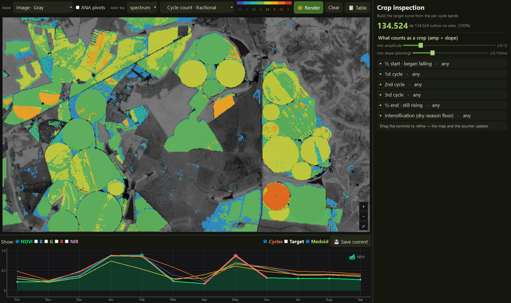

# cycle-navigator

[](https://www.python.org/)
[](https://github.com/osmarluiz/pheno-engine)
[](LICENSE)

Read cropping systems as a **label-free continuum** instead of looking them up in a legend. The tool
queries the landscape by curve shape and recolours it along any phenometric axis, live and
region-wide.



*A centre-pivot district colored by fractional cycle count. The counter reports how many fields in
view match the query, the right panel holds the operating-point sliders and the per-cycle query
bands, and the clicked field's curve is read below the map. Dragging any control updates map and
counter in place.*

## Why a navigator and not a map

The motivation is a finding about cropping intensity: between the one, two and three cycle classes the
data holds no empty space, and the threshold that produces the classes is undecidable within a band
that relabels a substantial share of the map. A continuum has no legend to read off, and an
undecidable threshold has no single map worth printing, so what is left is a reading the user moves.
This is that reading.

What you can do:

- **Recolour the cropland in view by any axis** the engine reads: fractional cycle count, per-cycle
  vigour, planting month, duration, fallow, dry-season activity.
- **Query by bands**: constrain any combination of axes and watch the map and the field counter
  update as you drag.
- **Move the operating point**: the amplitude floor and the slope gate are sliders, so you can see
  which fields change count when the threshold moves — the undecidable band, live.
- **Click a field** and read its year: the monthly curve with cycles shaded, next to the map.
- **Overlay a centre-pivot register** (optional) to compare the dry-season axis against declared
  irrigation.

## The engine is not in this repository, and that is the point

What a user drags here must be the same code that produces numbers in analyses elsewhere. So the
phenometric engine comes from [`pheno-engine`](https://github.com/osmarluiz/pheno-engine), pinned by
tag in `pyproject.toml` (`pheno-engine @ ... @v0.1.0`), and the map and curve widgets come from
[`ts-annotator`](https://github.com/osmarluiz/ts-annotator). This repository is the **application**:
configuration, assembly, entry point. It reimplements nothing.

`tests/test_motor_compartilhado.py` enforces it, and asks three separate questions:

1. is any engine file copied into this tree?
2. is any engine function redefined here under a different file name?
3. is the `pheno_engine` we import actually loaded from **outside** this tree?

The third exists because a stray `pheno.py` on the path would satisfy the first two and still break
the claim. Run them with `pytest`.

## Install

```bash
pip install -e ".[dev,pivots]"
```

`pivots` pulls `geopandas`, needed only to overlay a centre-pivot register. The tool opens without it.

## Configure

Paths are read from a file, never hard-coded. Copy `cycle-navigator.example.toml` to
`cycle-navigator.toml` and edit:

```toml
aoi   = "E:/sits_aoi_crop"
meses = [202210, 202211, 202212, 202301, 202302, 202303,
         202304, 202305, 202306, 202307, 202308, 202309]
```

The search order is `--config`, then `$CYCLE_NAVIGATOR_CONFIG`, then `./cycle-navigator.toml`, then
`~/.config/cycle-navigator/config.toml`. Every declared file is checked at start-up, so a wrong path
fails immediately with the offending name rather than thirty seconds into loading.

## Run

```bash
cycle-navigator                     # uses the config found by the search order
cycle-navigator --config other.toml
```

## Data

The tool reads a monthly satellite image time series over an area of interest: a twelve-month cube, a
few basemaps, and optionally a cropland prediction and a pivot register. It ships no data. It was
developed on a monthly PlanetScope series over the RIDE-DF in the Brazilian Cerrado, a region large
enough that the viewport is always a window into a ~9-billion-pixel year.

## Citing

If you use this tool, cite this repository and pin the versions of **both** engines of the claim:
this application and the `pheno-engine` tag it installs. "The same engine" is only checkable if the
reader knows which commit you mean.

## License

MIT.
